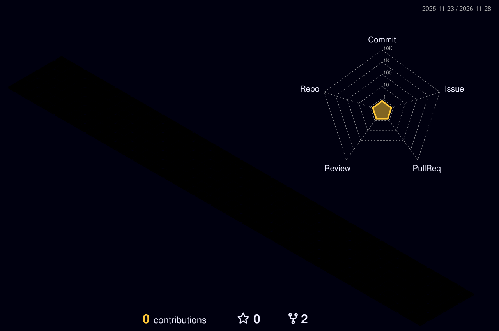

<h1 align="center">Hi, I'm Shishir Timilsina 👋</h1>

<!-- Typing animation -->

  

  
  

---

### 👋 About Me

- 🎓 Final-year **Computer Engineering** student at **IOE Thapathali Campus**, Nepal
- 💻 I build **real-world projects** across AI/ML, data and full-stack web development
- 📊 Studied **Artificial Intelligence** and **Data Mining**, and I like turning messy data into useful decisions
- 🌱 Always learning something new

---

### 🛠️ Tech Stack

   
   
  

---

### 🚀 Featured Projects

| Project | What it does | Stack |
|---|---|---|
| 🤖 **[RAG Telecom ChatBot](https://github.com/imccr/RAG-Telecom-ChatBot)** | Answers telecom customer questions from company documents, not model memory | Python, LLM, Embeddings, Vector DB |
| 🎥 **[Offline Exam Proctoring](https://github.com/imccr/OFFLINE-EXAM-PROCTORING-SYSTEM-USING-POSE-ESTIMATION-WITH-FINE-TUNED-RESNET50V2-ON-A-CUSTOM-DATASET)** | Detects suspicious behavior in exam halls with a live video dashboard | YOLOv11-Pose, ResNet50V2, FastAPI |
| 💊 **[KnowDDI-Nepal](https://github.com/imccr/knowddi-kg-builder)** | Drug-interaction knowledge graph covering 320 of Nepal's 324 essential medicines | Python, GNN, Knowledge Graphs |
| 📉 **[Customer Churn Prediction](https://github.com/imccr/Customer-Churn-Prediction)** | Predicts which customers will leave, and why | Python, Pandas, scikit-learn |
| 🌫️ **[Kathmandu PM2.5 Mining](https://github.com/imccr/kathmandu-pm25-mining)** | Finds weather patterns behind high pollution days | K-Means, Association Rules |
| 🏫 **[Resource Management System](https://github.com/imccr/resource-management-system)** | Full-stack platform for course materials with role-based access | Next.js, FastAPI, PostgreSQL |

---

### 🧊 3D Contribution Graph

  

---

### 📈 Languages

  

